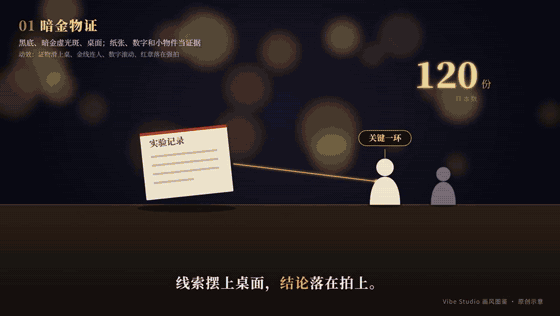
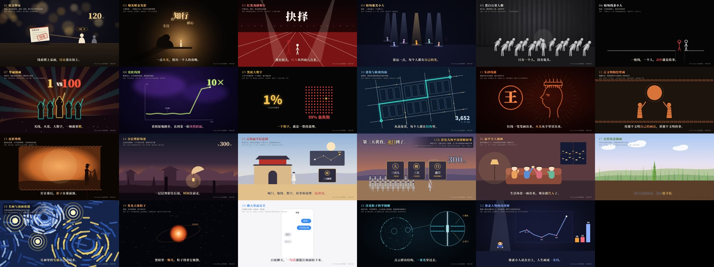
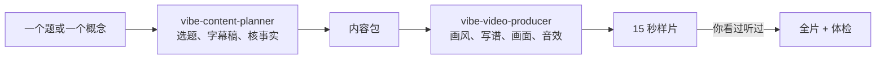

# Vibe Studio

把知识做成短片的开源工作室。音乐是全片的总谱，画面、动效和音效都从同一条时间线上长出来。配两个 Skill，Claude Code、Codex、Kimi Code、WorkBuddy、TRAE 这类 Agent 拿到一份内容包就能出片。

*A music-first studio for short knowledge films, built on [Remotion](https://www.remotion.dev). The score is the master clock: picture, motion and sound effects all read from it. Music and effects are synthesised from code, so renders carry no third-party rights.*

<p align="center"></p>

## 看看做出来的样子

| 示例片《沉没成本》 | Agent 用 Skill 做的《峰终定律》 |
|---|---|
| [](docs/showcase/sunk-cost.mp4) | [](docs/showcase/peak-end.mp4) |
| 工程自带的示例，源码在 `films/sunk-cost`。一张电影票贯穿全片，配乐和音效都由代码合成。点图看带声音的片段。 | 在一份全新安装的副本里，Agent 读两个 Skill，从 [这份内容包](examples/peak-end-package.md) 做出的 20 秒样片。拿同一份内容包可以试你自己的 Agent。 |

**画风图鉴**：“Vibe 知识”类短片常见的 22 种画风，每种一段 8 秒原创示意片，画法和典型动效都在里面。点图进图鉴，每段都能单独看。

[](docs/STYLE-GALLERY.md)

## 它做什么

- **两种创作方式**：照参考案例学手法，或者从一个世界观原创。两条路都收束成同一份导演方案。
- **音乐先行**：先写谱，再剪片。换和弦、落拍、休止都是画面可以读取的事件，改速度时全片一起移动。
- **原创音乐和音效**：代码写谱、本地合成，同时导出 MIDI，可以换成真人演奏或自己的音色。
- **画风库、音乐库、音效库、动效库**：都是可读可改的文件，加一种风格只需要加一个文件。

一条片子在 Agent 手里是这样走的：



## 安装

### 最快：把这句话发给你的 AI

用 Claude Code、Codex、Kimi Code、WorkBuddy、TRAE 这类**能执行终端命令**的 Agent，新开一个对话，发：

> 请阅读 https://raw.githubusercontent.com/guoxuxin888-lab/vibe-studio/main/AI-INSTALL.md ，照着它帮我安装 Vibe Studio，并把它的两个 Skill 装进你自己。

它会自己做完这些：

- 拉下工程；
- 装 Node 20+ 和 ffmpeg；
- 装依赖和渲染用的浏览器；
- 跑体检、试渲染一帧；
- 把 `vibe-content-planner`、`vibe-video-producer` 装进它的技能目录。

遇到要你输密码或点授权的地方，它会停下来等你。装完新开一个对话，就能让它做片。

### 或者：一行命令

不用 Agent，也可以复制一行命令到终端，效果一样：

- 先下载工程，默认放到用户目录下的 `vibe-studio`；
- 再跑一键安装脚本；
- 最后把 Skill 装进本机已有的 Agent。

**Windows**：打开 PowerShell，粘贴运行：

```bash
irm https://raw.githubusercontent.com/guoxuxin888-lab/vibe-studio/main/setup/bootstrap.ps1 | iex
```

国内网络：先运行这一行，再运行上面那行：

```bash
$env:VIBE_CHINA = '1'
```

想换目录，先运行这一行，再运行上面那行：

```bash
$env:VIBE_DIR = 'D:\vibe-studio'
```

**macOS / Linux**：

```bash
curl -fsSL https://raw.githubusercontent.com/guoxuxin888-lab/vibe-studio/main/setup/bootstrap.sh | bash
```

国内网络：

```bash
curl -fsSL https://raw.githubusercontent.com/guoxuxin888-lab/vibe-studio/main/setup/bootstrap.sh | bash -s -- --china
```

运行网上的脚本之前，可以先点开链接看一眼它做什么：[bootstrap.ps1](setup/bootstrap.ps1)、[bootstrap.sh](setup/bootstrap.sh)、[install.ps1](setup/install.ps1)、[install.sh](setup/install.sh)、[install-skills.mjs](setup/install-skills.mjs)。

### 分步安装

要三样东西：**Node.js 20 以上**、**ffmpeg**、本工程的依赖。上面两种不合适时，下面三种方法选一种。

先拿到工程：会用 git 就 `git clone https://github.com/guoxuxin888-lab/vibe-studio.git`；不会的话在 GitHub 页面点绿色的 **Code → Download ZIP**，解压到一个**路径里没有空格**的文件夹，比如 `D:\vibe-studio`。

#### 方法一：一键安装脚本（推荐）

脚本会检查 Node 和 ffmpeg，缺了就自动装，已经装好的跳过；然后装依赖、准备渲染用的浏览器、跑体检、真的渲染一帧确认整条链能用，最后把两个 Skill 装进本机已有的 Agent（只装给某一个就加 `-Agent claude` 或 `--agent=claude`，可选 claude、codex、kimi、trae、workbuddy）。

**Windows 10 / 11**：双击工程里的 `setup\install-windows.cmd`。

国内网络慢，就在工程目录打开命令行，运行：

```bash
setup\install-windows.cmd -China
```

`-China` 只让本工程的 npm 走国内镜像 npmmirror（写在工程根目录的 `.npmrc`，不影响别的项目）。Windows 上用系统自带的 winget 安装 Node LTS 和 ffmpeg，过程中可能弹出管理员授权，点“是”。

**macOS / Linux**：在工程目录运行：

```bash
bash setup/install.sh
```

国内网络加 `--china`：

```bash
bash setup/install.sh --china
```

macOS 用 Homebrew 装 Node 和 ffmpeg（没有 Homebrew 先按 [brew.sh](https://brew.sh) 装上）；Linux 用 nvm 装 Node 22，用 apt / dnf / pacman 装 ffmpeg 和无头浏览器要的系统库，会要 sudo 密码。

看到“全部完成”，并且多出一张 `out/setup-check.png`，就装好了。

#### 方法二：工程已经下载了，让 AI 接着装

在工程文件夹里打开 Agent，发一句：

> 照 AI-INSTALL.md 帮我把这个工程装好，并把两个 Skill 装进你自己。

[AI-INSTALL.md](AI-INSTALL.md) 里写了它该怎么做，和方法一的脚本是同一套步骤；Agent 每条命令执行前，你可以看一眼它要做什么。

#### 方法三：从官网下载，手动安装

**1. Node.js 20 以上**

- 官网：[nodejs.org](https://nodejs.org/zh-cn/download) 下载 **LTS** 版。Windows 选 `.msi` 安装包，一路下一步，保持勾选“Add to PATH”；macOS 选 `.pkg`。
- 国内下得慢：到 [npmmirror 的 Node 镜像](https://npmmirror.com/mirrors/node/) 选最新的 `v22.x` 目录，下载同样的安装包。
- Linux：用 [nvm](https://github.com/nvm-sh/nvm) 安装 `nvm install 22`，国内先设 `export NVM_NODEJS_ORG_MIRROR=https://npmmirror.com/mirrors/node`。

**2. ffmpeg**

- Windows：到 [gyan.dev](https://www.gyan.dev/ffmpeg/builds/) 下载 `ffmpeg-release-essentials.zip`，解压到比如 `C:\ffmpeg`，把 `C:\ffmpeg\bin` 加进系统环境变量 PATH（开始菜单搜“编辑系统环境变量” → 环境变量 → Path → 新建）。
- macOS：`brew install ffmpeg`，或到 [evermeet.cx](https://evermeet.cx/ffmpeg/) 下载。
- Ubuntu / Debian：`sudo apt install ffmpeg`。其他系统见 [ffmpeg.org](https://ffmpeg.org/download.html)。

**3. 检查**：**关掉再重新打开**终端，运行下面两条，都能打出版本号就对了。

```bash
node -v
```

```bash
ffmpeg -version
```

**4. 装依赖，跑起来**：在工程根目录依次运行。

```bash
npm ci
```

```bash
npm run doctor
```

```bash
npm run music -- sunk-cost
```

```bash
npm run studio
```

浏览器里会打开 Remotion Studio，能看到示例片《沉没成本》在播放。示例片在 `films/sunk-cost`，先读它的 `treatment.md` 和 `score.mjs`，这是整套方法最短的样子。

**5. 中文字体（建议）**：装 [思源宋体 Noto Serif SC](https://fonts.google.com/noto/specimen/Noto+Serif+SC)，示例片和图鉴都按它排版；不装会退回系统宋体。Linux 上可以 `sudo apt install fonts-noto-cjk`。

### 常见问题

- **npm 装得很慢或报网络错**：运行 `npm config set registry https://registry.npmmirror.com --location=project`，再 `npm ci`。
- **渲染时下载浏览器失败**：在工程根目录新建 `studio.local.json`，指向本机的 Edge 或 Chrome（路径用正斜杠）：

  ```json
  { "browserExecutable": "C:/Program Files (x86)/Microsoft/Edge/Application/msedge.exe" }
  ```

  Mac 上常见路径是 `/Applications/Google Chrome.app/Contents/MacOS/Google Chrome`。一键安装脚本下载失败时会自动写这个文件。
- **系统盘空间小**：在同一个文件里加 `"tempDir": "E:/vibe-tmp"`，渲染的临时文件就放到别的盘。
- **装完提示找不到 node 或 ffmpeg**：PATH 要在新开的终端里才生效，关掉窗口重新打开再试。
- **Windows 提示“禁止运行脚本”**：用 `setup\install-windows.cmd` 启动，它只对这一次运行放开 PowerShell 的执行策略，不改系统设置。
- **Linux 渲染报缺 `libnss3`、`libgbm` 之类的库**：运行 `bash setup/install.sh`，它会装上这些库；或照报错用 apt 装上缺的包。
- **`npm run doctor` 报 Node 版本太旧**：按上面任一方法装 Node 20 以上，旧版本不用卸载，新装的会排在前面。

## 做一部新片

```bash
# 原创
npm run new -- my-film --package 内容包.md --mode original --style ink-wash --mood ink-and-time

# 参考
npm run reference -- 案例.mp4 --id case-01
npm run new -- my-film --package 内容包.md --mode reference --reference case-01 --style blueprint --mood mechanism

npm run music -- my-film
npm run render -- my-film out/my-film.mp4
npm run doctor
```

## 用 Agent 来做

`skills/` 里有两个 Skill：`vibe-content-planner`（选题和写稿）和 `vibe-video-producer`（画面、音乐、成片）。装进 Claude Code、Codex、Kimi Code、WorkBuddy 或 TRAE 后，把内容包交给它就能开做，安装方法见 [skills/README.md](skills/README.md)。你自己的账号规则写进 `profile.local.md`（模板 [profile.example.md](profile.example.md)）。

装好以后可以先拿示例内容包试一条，发给 Agent：

> 用 vibe-video-producer，把 examples/peak-end-package.md 做成一条约 20 秒的样片。原创音乐，画风用 geo-flat。先跑 npm run doctor。做完告诉我成片路径，并说清哪些没看过、没听过。

想试策划：

> 用 vibe-content-planner，给“拖延”这个方向出 3 个 Vibe 知识选题，每个写目标、片型、时长、第一句、贯穿物、依据来源和风险。

模型越强，画面写得越好。豆包 App 本身是聊天工具，跑不了本地渲染；想用豆包模型，请用 TRAE。

## 目录

```
setup/       一键安装脚本（Windows、macOS、Linux）
engine/      作曲和合成：乐理、音色、音效、时间线
src/         Remotion：音乐时钟、动效组件、画风
libraries/   画风库、音乐库、音效库、动效库
films/       每部片一个目录：内容包、导演方案、总谱、画面
examples/    示例内容包
tools/       建片、参考分析、体检、混音封装、音画同步检查
skills/      给 Agent 用的两个 Skill
references/  你的参考片拆解，只留在本地，不进仓库
docs/        设计和方法、画风图鉴、案例素材
```

- [项目设计](docs/DESIGN.md)
- [音乐怎么决定画面](docs/MUSIC.md)
- [动效库](libraries/motion/README.md)
- [画风图鉴](docs/STYLE-GALLERY.md)：常见画风各一段 8 秒原创示意片

## 许可

代码、画风、谱子和合成产物按 [MIT](LICENSE) 发布。依赖的 Remotion 有自己的许可，公司使用可能需要付费，详见 [NOTICE](NOTICE.md)。
