# 画风图鉴

“Vibe 知识”类短片常见的 22 种画风（第 15 类分两支，共 23 段）。每段 8 秒的原创示意：底色、光、人物和字的画法，加上这种画风最典型的动效，全部按 90 BPM 的拍子落点（一段 12 拍，最重的那一下在第 8 拍），配乐由工程合成。

这些示意片只取一类画风的共同特征，不复制任何一条参考片的镜头、人物、文案或构图；片子里的字和数字都是示意。点图片看片段。片段源码在 `films/style-gallery/`，可以自己改、自己加：

```bash
npm run music -- style-gallery
node tools/remotion.cjs render style-gallery out/style-gallery.mp4
```

| | 画风 | 画面 | 典型动效 | 常配什么题 | 内置配方 |
|---|---|---|---|---|---|
| [](gallery/01-dark-gold.mp4) | **01 暗金物证** | 黑底、暖金虚光斑、桌面；纸张、数字、小物件当证据 | 证物滑上桌、金线连人、数字滚动、红章落在强拍 | 证据片、心理实验、数字冲击 | `quiet-night` 最接近 |
| [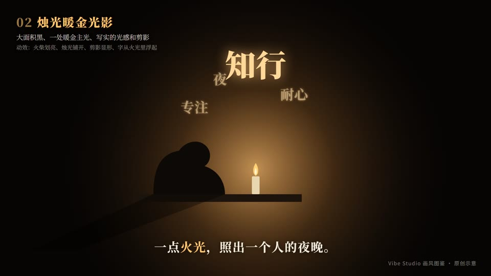](gallery/02-candlelight.mp4) | **02 烛光暖金光影** | 大面积黑、一处暖金主光、写实的光感和剪影 | 火柴划亮、烛光铺开、剪影显形、字从火光里浮起 | 哲学、人生、仪式感 | 待写 |
| [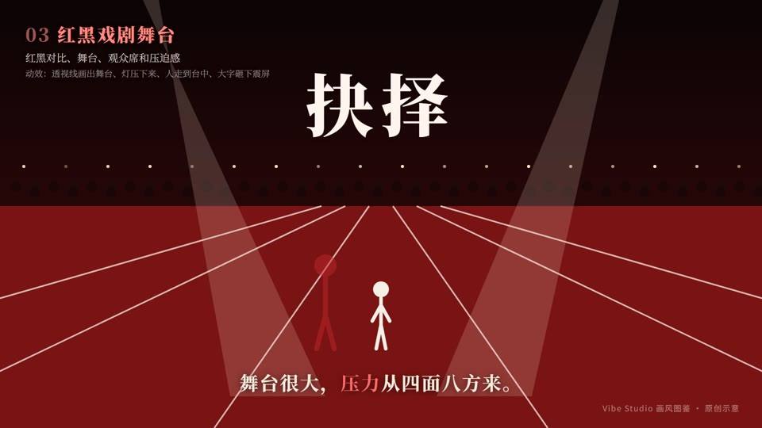](gallery/03-red-stage.mp4) | **03 红黑戏剧舞台** | 红黑对比、舞台、观众席和压迫感 | 透视线画出舞台、灯压下来、人走到台中、大字砸下震屏 | 权力、他人、群体压力 | `velvet-stage` |
| [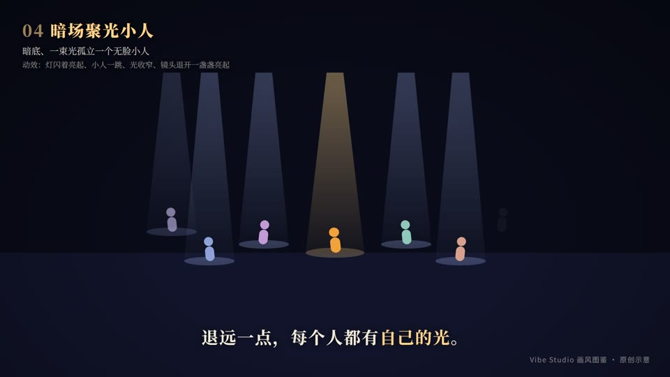](gallery/04-spotlight.mp4) | **04 暗场聚光小人** | 暗底、一束光孤立一个无脸小人 | 灯闪着亮起、小人一跳、光收窄、镜头退开一盏盏亮起 | 孤独、被注视、一个人的处境 | `velvet-stage` |
| [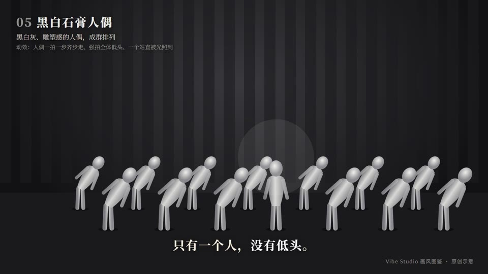](gallery/05-plaster.mp4) | **05 黑白石膏人偶** | 黑白灰、雕塑感的人偶，成群排列 | 人偶一拍一步齐步走、强拍全体低头、一个站直被光照到 | 存在主义、从众、荒诞 | 待写 |
| [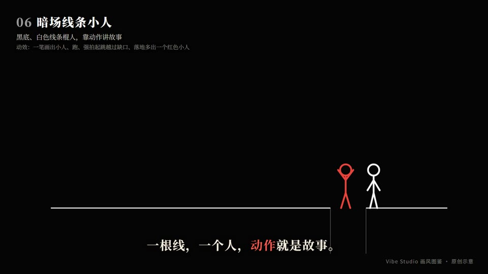](gallery/06-line-figure.mp4) | **06 暗场线条小人** | 黑底、白色线条棍人，靠动作讲故事 | 一笔画出小人、跑、强拍起跳越过缺口、落地多出一个红色小人 | 短片、对比、整活 | 待写 |
| [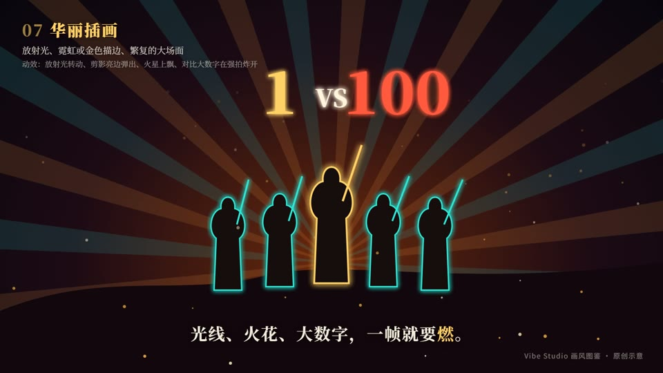](gallery/07-ornate.mp4) | **07 华丽插画** | 放射光、霓虹或金色描边、繁复的大场面 | 放射光转动、剪影亮边弹出、火星上飘、对比大数字在强拍炸开 | 燃片、英雄 | 待写 |
| [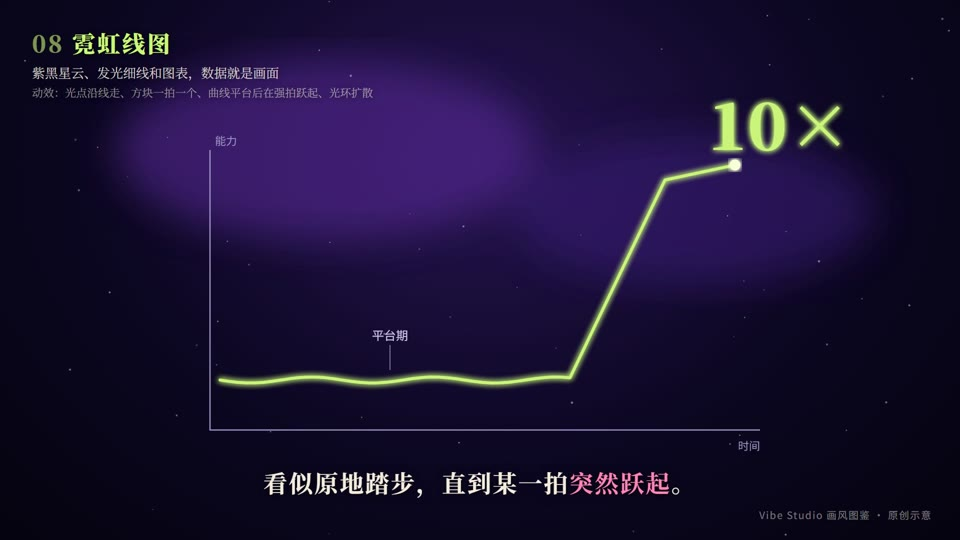](gallery/08-neon-graph.mp4) | **08 霓虹线图** | 紫黑星云、发光细线和图表，数据就是画面 | 光点沿线走、方块一拍一个、曲线平台后在强拍跃起、光环扩散 | 科学、方法论、关系变化 | 待写 |
| [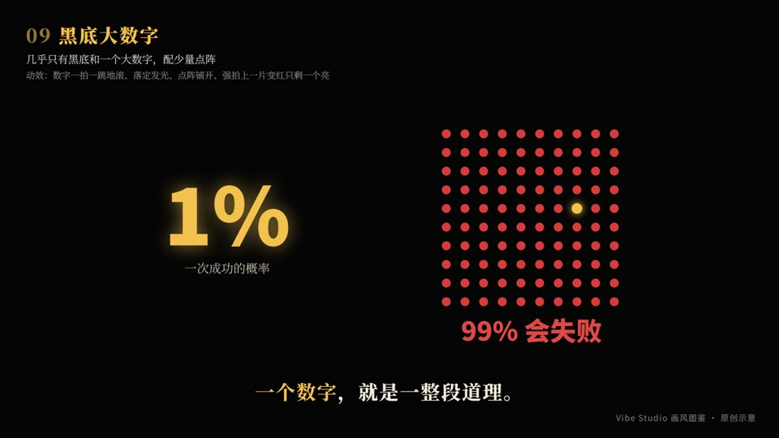](gallery/09-big-number.mp4) | **09 黑底大数字** | 几乎只有黑底和一个大数字，配少量点阵 | 数字一拍一跳地滚、落定发光、点阵铺开、强拍上一片变红只剩一个亮 | 概率、临界点、一个数字讲透 | 待写 |
| [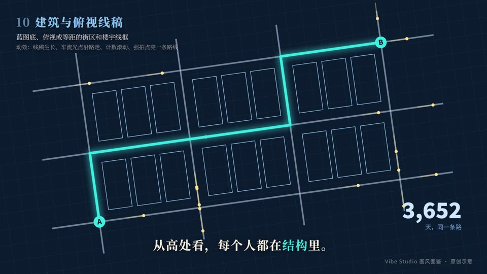](gallery/10-blueprint.mp4) | **10 建筑与俯视线稿** | 蓝图底、俯视或等距的街区和楼宇线框 | 线稿生长、车流光点沿路走、计数滚动、强拍点亮一条路线 | 命运、系统、人在结构里 | `blueprint` |
| [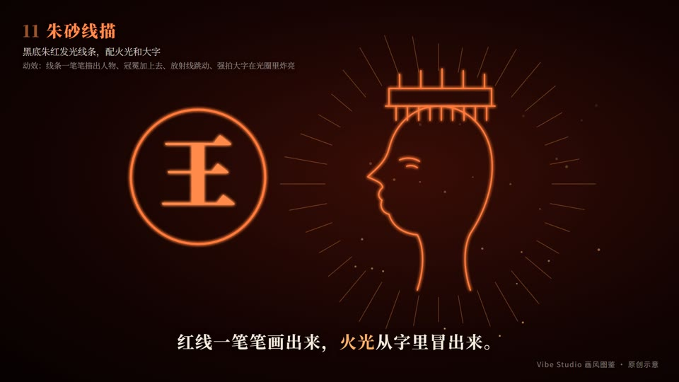](gallery/11-cinnabar.mp4) | **11 朱砂线描** | 黑底朱红发光线条，配火光和大字 | 线条一笔笔描出人物、冠冕加上去、放射线跳动、强拍大字在光圈里炸亮 | 帝王、历史人物 | `cinnabar-line` |
| [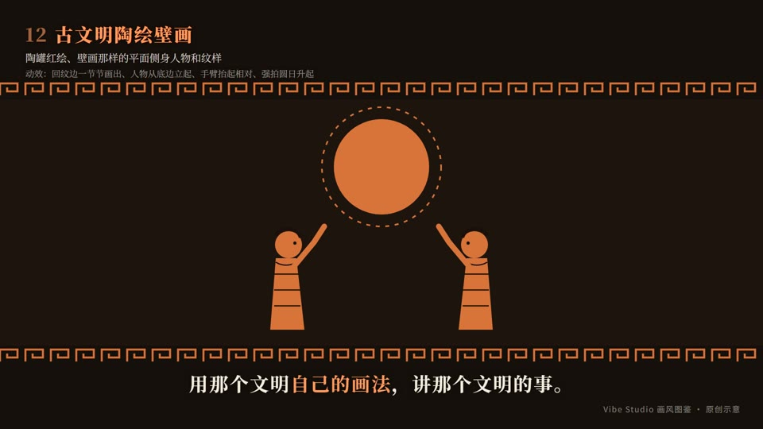](gallery/12-vase-mural.mp4) | **12 古文明陶绘壁画** | 陶罐红绘、壁画那样的平面侧身人物和纹样 | 回纹边一节节画出、人物从底边立起、手臂抬起相对、强拍圆日升起 | 神话、古代思想 | `vase-figure` |
| [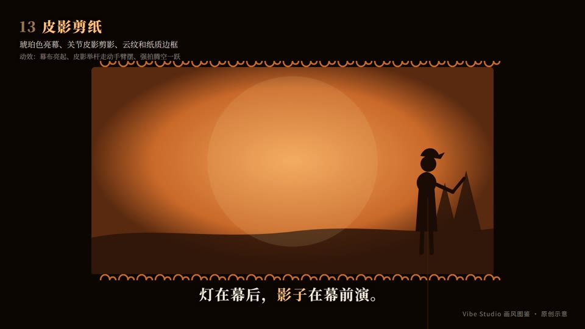](gallery/13-shadow-puppet.mp4) | **13 皮影剪纸** | 琥珀色亮幕、关节皮影剪影、云纹和纸质边框 | 幕布亮起、皮影举杆走动手臂摆、强拍腾空一跃 | 中国神话、古籍 | `shadow-puppet`、`shadow-theatre` |
| [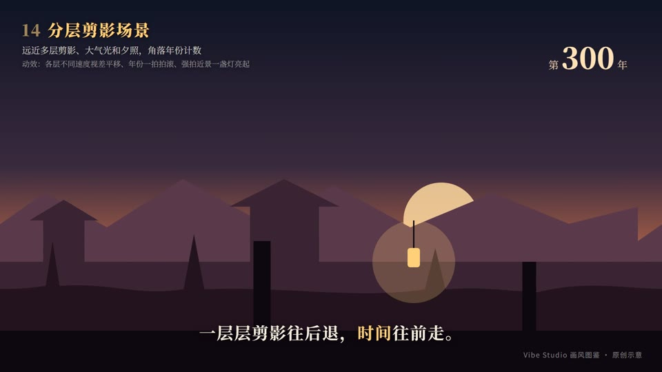](gallery/14-layered-silhouette.mp4) | **14 分层剪影场景** | 远近多层剪影、大气光和夕照，角落年份计数 | 各层不同速度视差平移、年份一拍拍滚、强拍近景一盏灯亮起 | 第二人称历史、穿越时间 | 待写 |
| [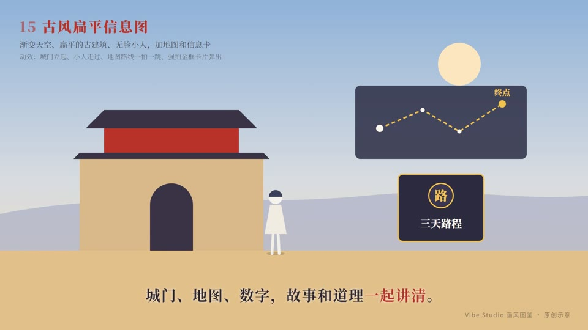](gallery/15-flat-infographic.mp4) | **15 古风扁平信息图** | 渐变天空、扁平的古建筑、无脸小人，加地图和信息卡 | 城门立起、小人走过、地图路线一拍一跳、强拍金框卡片弹出 | 古代制度、历史故事、冷知识 | `han-flat` |
| [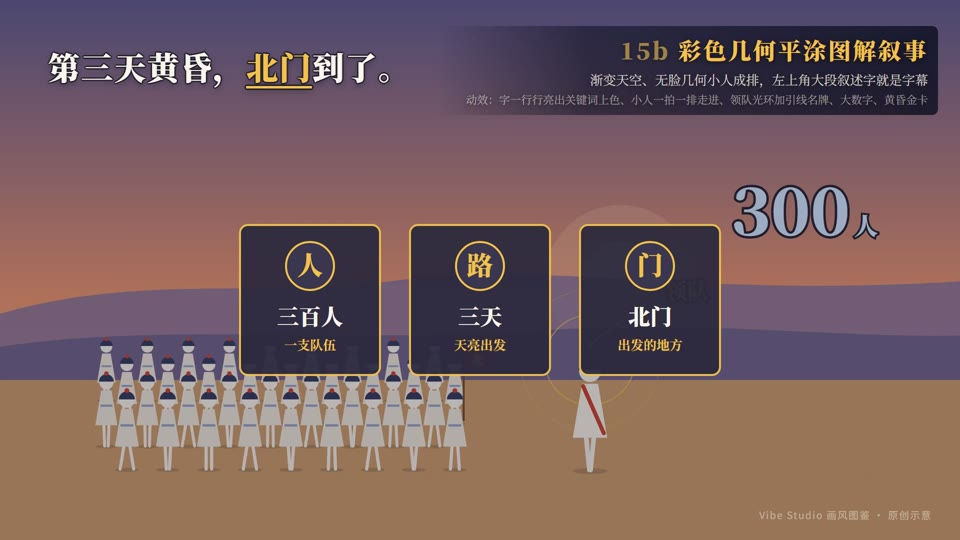](gallery/15b-geo-narrative.mp4) | **15b 彩色几何平涂图解叙事** | 第 15 类的另一支：渐变天空和层叠远山，白色无脸几何小人成排，左上角大段叙述字就是字幕 | 字一行行亮出、关键词上色加下划线，小人一拍一排走进，主角光环加金色引线名牌，角落大数字，黄昏里金框卡一拍一张 | 历史事件、群像、一段过程的图解 | `geo-flat` |
| [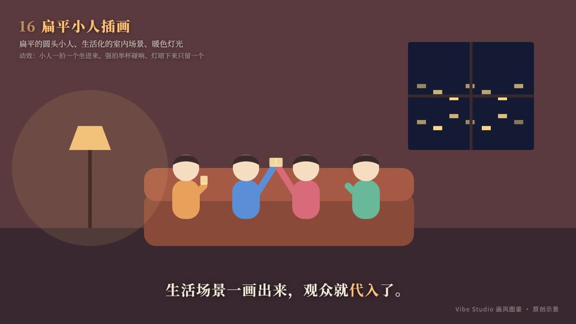](gallery/16-flat-people.mp4) | **16 扁平小人插画** | 扁平的圆头小人、生活化的室内场景、暖色灯光 | 小人一拍一个坐进来、强拍举杯碰响、灯暗下来只留一个 | 心理、日常、关系 | `paper-collage` |
| [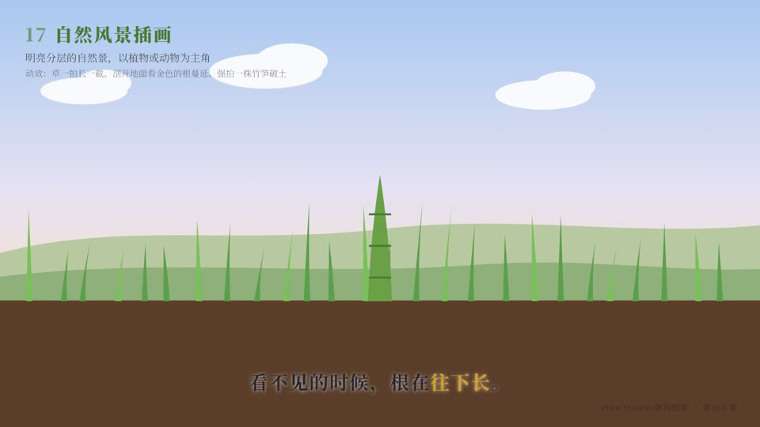](gallery/17-nature.mp4) | **17 自然风景插画** | 明亮分层的自然景，以植物或动物为主角 | 草一拍长一截、剖开地面看金色的根蔓延、强拍一株竹笋破土 | 成长、本能 | 待写 |
| [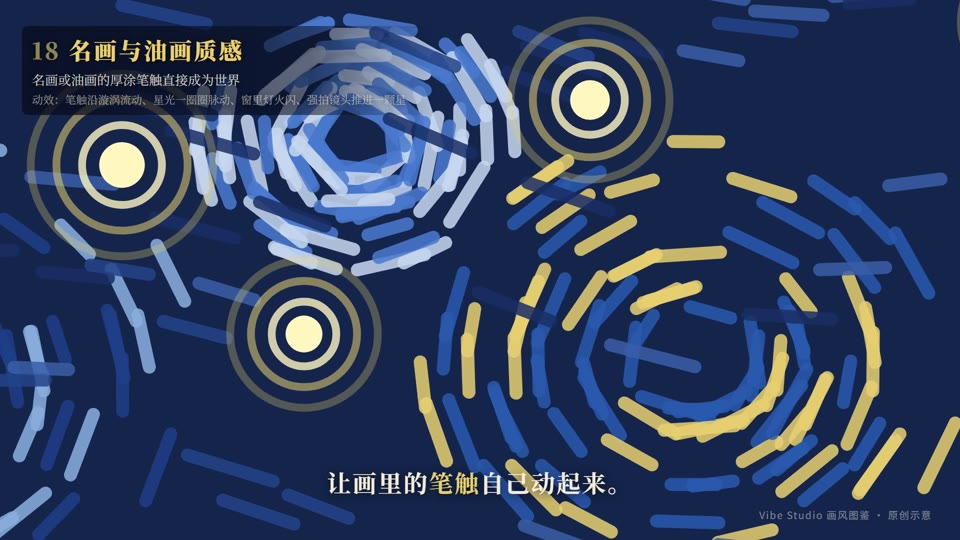](gallery/18-oil-painting.mp4) | **18 名画与油画质感** | 名画或油画的厚涂笔触直接成为世界 | 笔触沿漩涡流动、星光一圈圈脉动、窗里灯火闪、强拍镜头推进一颗星 | 艺术家、名画 | 待写 |
| [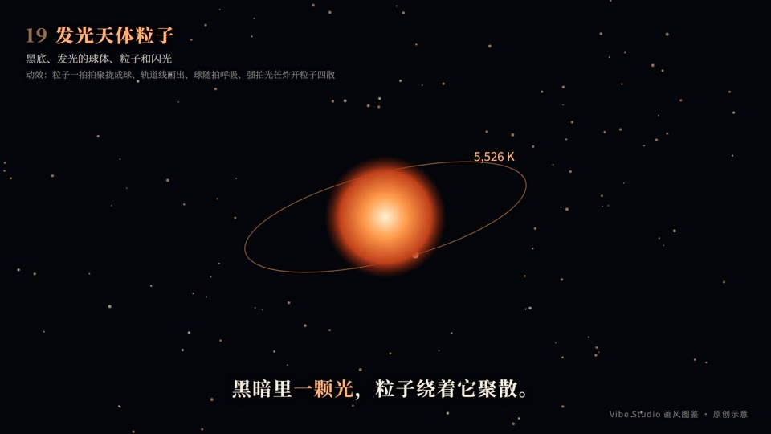](gallery/19-glowing-orbs.mp4) | **19 发光天体粒子** | 黑底、发光的球体、粒子和闪光 | 粒子一拍拍聚拢成球、轨道线画出、球随拍呼吸、强拍光芒炸开粒子四散 | 生命、自然现象 | 待写 |
| [](gallery/20-chat-contrast.mp4) | **20 聊天界面反差** | 白底聊天界面，转暗场，再转暖 | 气泡一拍一条弹出、正在输入、整屏转暗只剩等待的光点、暖光回来 | 内心戏、过度思考 | 待写 |
| [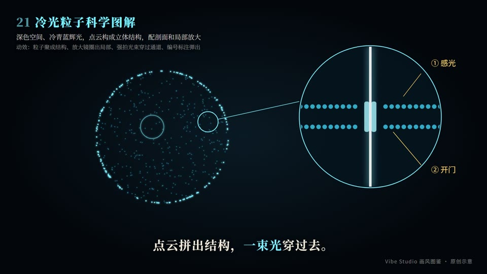](gallery/21-cold-particles.mp4) | **21 冷光粒子科学图解** | 深色空间、冷青蓝辉光，点云构成立体结构，配剖面和局部放大 | 粒子聚成结构、放大镜圈出局部、强拍光束穿过通道、编号标注弹出 | 前沿科学 | 待写 |
| [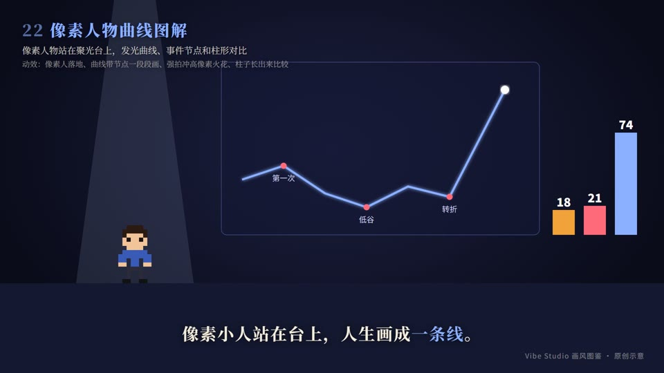](gallery/22-pixel-curve.mp4) | **22 像素人物曲线图解** | 像素人物站在聚光台上，发光曲线、事件节点和柱形对比 | 像素人落地、曲线带节点一段段画、强拍冲高像素火花、柱子长出来比较 | 人生经历、对比 | 待写 |

分类来自对公开爆款的人工拉片，只说明“有这样一类画法”，不代表哪种画风更容易爆。选画风先问“这个概念的质地是什么”，方法见 `skills/vibe-video-producer/references/visual.md`。“内置配方”写“待写”的，是 `libraries/styles/` 里还没有对应的画风文件，欢迎补。
